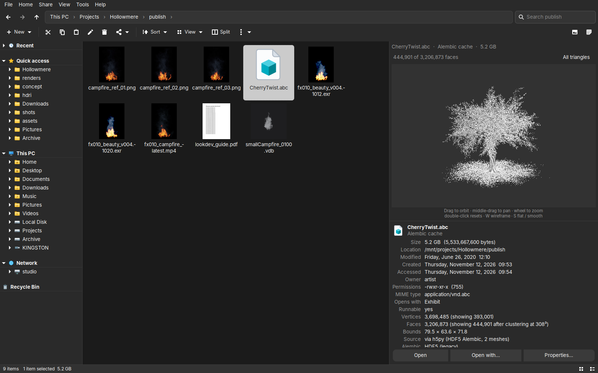
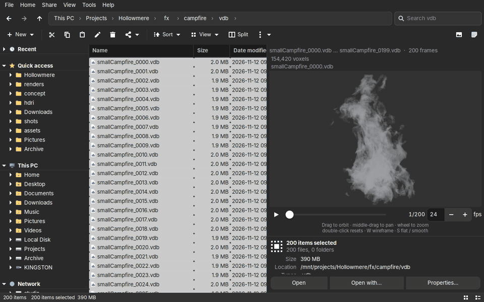
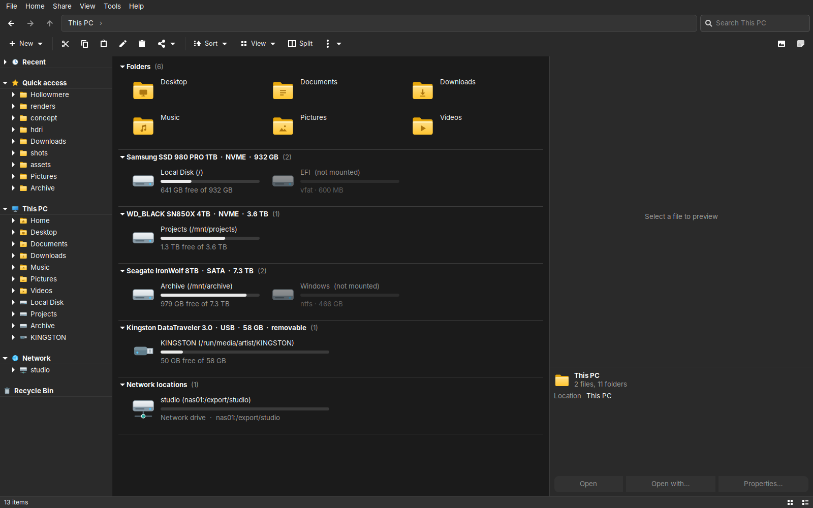
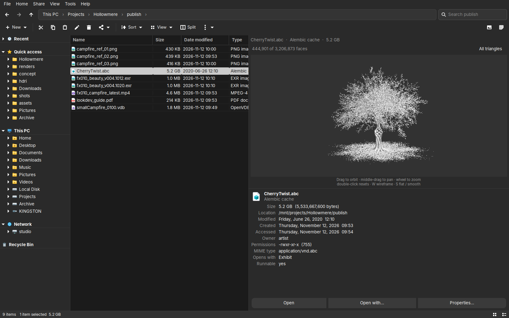
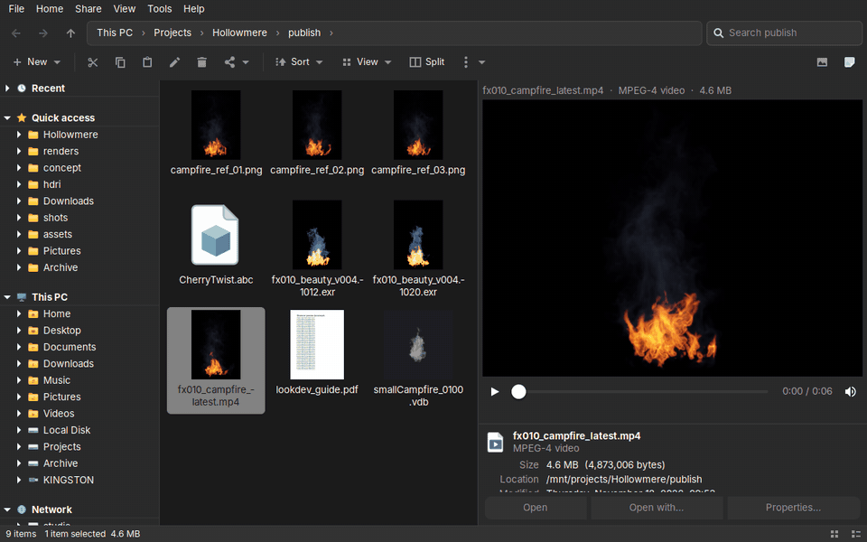
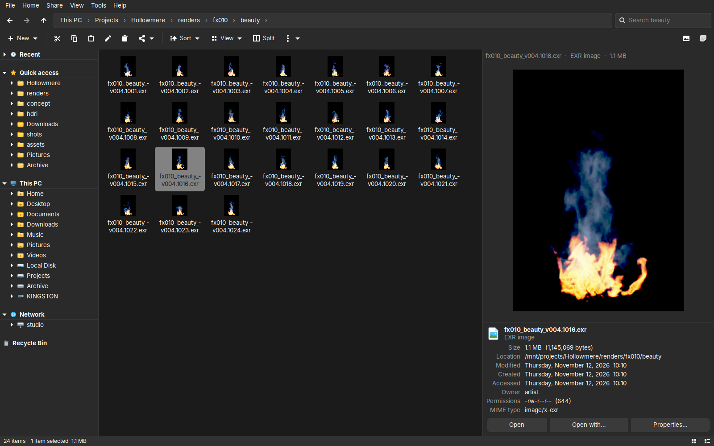
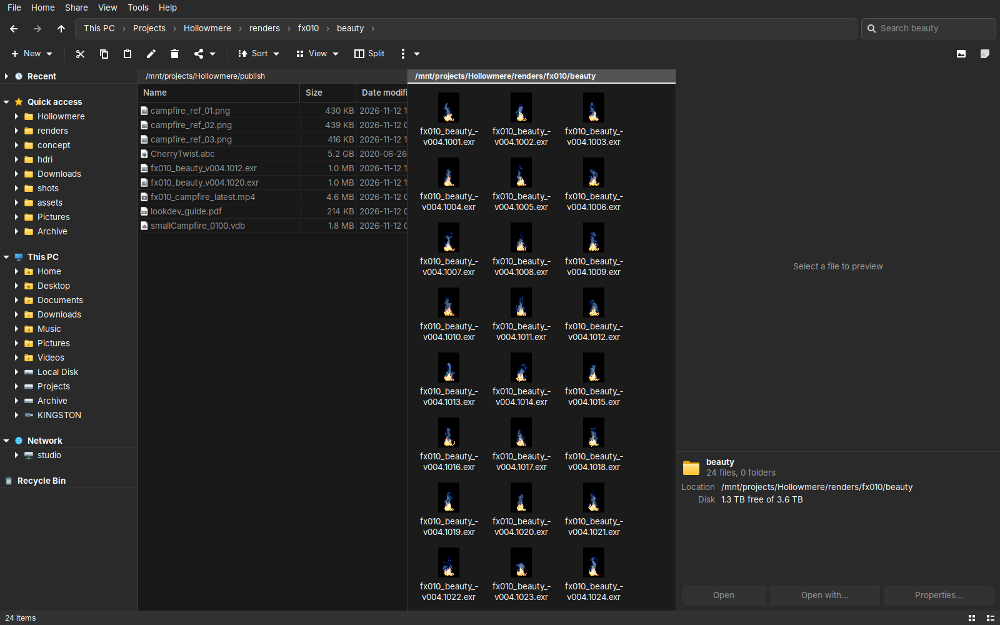
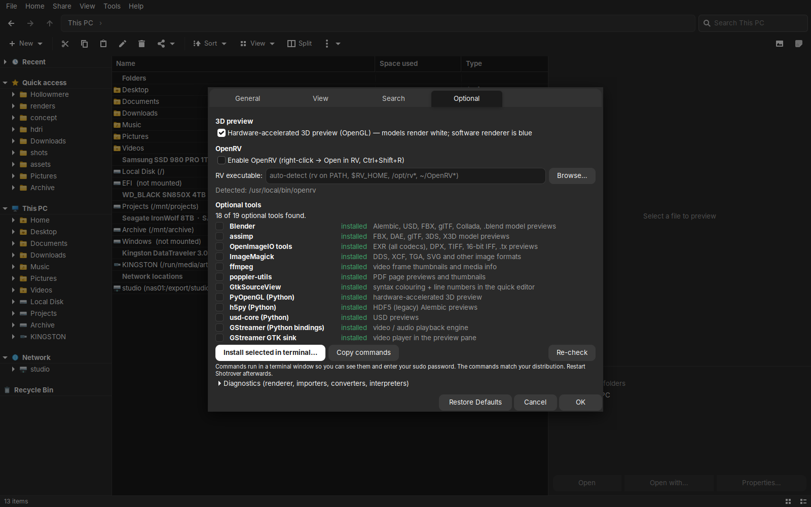

<div align="center">


# Shotrover

**A fast, friendly file manager for Linux that understands your work files.**

Familiar Explorer-style layout, on any distro, with previews for the things other file managers
show as a grey icon: EXR, PSD, video, 3D models, VDB smoke, Maya / Blender / Unreal / Unity scenes.

[](https://github.com/KCArrow/shotrover/actions/workflows/ci.yml)


[](#licence)
[](https://ko-fi.com/kalibarrowsmith)

[Get started](#get-started) · [What it does](#what-it-does) · [Optional extras](#optional-extras) · [Help](#help-and-troubleshooting) · [Report a problem](https://github.com/KCArrow/shotrover/issues/new/choose)

</div>

<!-- The stills show a fictional machine, not a real one. -->


---

## Get started

Shotrover is one Python file with **no pip dependencies**. It needs Python 3.9 or newer and GTK 3,
which most Linux desktops already have installed.

**1. Make sure GTK's Python bindings are there** (skip this if you use GNOME, it is almost certainly done):

| Distro family | Command |
|---|---|
| Fedora, RHEL, Rocky, AlmaLinux | `sudo dnf install python3-gobject gtk3` |
| Debian, Ubuntu, Mint, Pop!_OS | `sudo apt install python3-gi gir1.2-gtk-3.0` |
| Arch, CachyOS, Manjaro, EndeavourOS | `sudo pacman -S python-gobject gtk3` |
| openSUSE | `sudo zypper install python3-gobject python3-gobject-Gdk typelib-1_0-Gtk-3_0` |

On anything else, install the packages your distro calls *PyGObject* and *GTK 3*.

**2. Install Shotrover** (no root needed, everything goes in your home folder):

```bash
git clone https://github.com/KCArrow/shotrover.git
cd shotrover
./install.sh
```

**3. Run it** from your app menu, or from a terminal:

```bash
shotrover ~/Pictures
```

<details>
<summary><b>Other ways to run it</b></summary>

- **Portable, nothing installed.** Download `shotrover-<version>-portable.zip` from the
  [Releases page](https://github.com/KCArrow/shotrover/releases), unzip it anywhere and run `./shotrover`.
  More in [Portable build](#portable-build).
- **Straight from the source folder:** `python3 shotrover.py [folder…]`
- **Make it your default file manager:** `xdg-mime default shotrover.desktop inode/directory`
- **Uninstall:** `./install.sh --uninstall` (your settings in `~/.config/shotrover` are kept)

</details>

### Which distros does it run on?

Any Linux desktop with GTK 3 and Python 3.9+, on X11 or Wayland, with any desktop environment.
It is developed day to day on Rocky Linux 9, the automated tests run on Ubuntu, and it is also used
on Fedora and Arch / CachyOS. Nothing in it is tied to one distribution: optional tools are found at
runtime wherever your distro puts them, and the in-app installer writes commands for `dnf`, `apt`,
`pacman` or `zypper` depending on what you have.

If something doesn't work on your distro, that is a bug.
[Tell me about it](https://github.com/KCArrow/shotrover/issues/new/choose) and include the distro name.

---

## A quick look



*VDB smoke in the preview pane: select the frames, press **Preview as sequence**, scrub or play. No Houdini needed.*

<sub>Campfire VDB set made with EmberGen by [JangaFX](https://jangafx.com/software/embergen/download/free-vdb-animations/), released as CC0.</sub>

| This PC | 3D preview | Video playing in the preview pane |
|---|---|---|
|  |  |  |

| EXR preview | Split view | Preferences → Optional |
|---|---|---|
|  |  |  |

---

## What it does

### 🗂️ Everyday file management

- **A layout you already know.** Menu bar, command bar, breadcrumb address bar you can type into
  (with Tab completion), tabs you can drag out into their own window, split view, and a navigation
  pane with Quick access, This PC and the Recycle Bin.
- **Eight views.** Extra large icons down to small, List, Details, Tiles and Content. Sort and group
  by any column. A folder with 100,000 files scrolls as smoothly as one with 100.
- **File operations that stay out of your way.** Copy, move, delete and rename run in the
  background with speed, time remaining, pause and cancel. Undo with Ctrl+Z. A real Recycle Bin.
  Copy, paste and drag-and-drop work with other apps.
- **Batch rename** (Ctrl+F2) with patterns, numbering, regex and frame-number offsets
  (`shot.1001.exr` +60 → `shot.1061.exr`, padding kept), and it can move the renamed files into
  another folder in the same step.
- **Archives.** Zip and tar open and extract natively; `.7z`, `.rar`, `.cab`, `.iso` and more work
  once 7-Zip is installed.
- **Find large files** (Tools menu). Scans a folder or a whole drive and shows what is taking the
  space. Frame sequences count as one item (`render.1001–1240.exr`), system files are flagged so
  you don't remove them by accident, and whatever you tick goes to the Recycle Bin.
- **Your choice of look.** Shotrover's own icon set or your desktop's icons, and light, dark or
  follow-the-desktop colours. Asked on first start, changeable in Preferences → View.

### 👀 Previews for nearly everything

- **Images:** the usual formats plus **EXR**, **Radiance HDR**, **Maya IFF** and **Photoshop
  PSD/PSB**. Animated GIF and WebP play in place.
- **Video and audio** playback, right in the preview pane.
- **3D models:** OBJ, STL, PLY, FBX, glTF, Alembic, USD and `.blend`, with orbit, zoom, wireframe
  and smooth shading. Works without a GPU (five million triangles in under a second) and uses
  OpenGL when available.
- **Text and code** with syntax highlighting and a quick inline editor, **PDF** (page by page),
  folder contents with sizes, archive listings and media info.
- **Thumbnails in the file list** for all of the above: EXR, HDR, PSD, video, PDF and 3D models
  show their contents in the icon layouts, not a file-type icon.

### 🎬 Made for VFX, animation and game work

- **Houdini caches and VDBs.** `.vdb` volumes render as smoke, read by Shotrover itself, so no
  Houdini licence is needed. `.bgeo` meshes and particles work through Houdini when it is
  installed. Select the frames of a cache to get a time slider with playback.
- **Scene breakdowns.** See what is inside a scene before opening it: Unreal (`.umap`, `.uasset`,
  `.uproject`), Unity (`.unity`, `.prefab`, `.unitypackage`), Maya (`.ma`, `.mb`) and Blender
  (`.blend`) show an outliner, materials, render settings and **every referenced file, flagged
  when it is missing**. None of those apps need to be installed. Pick an object to see its
  geometry, a material to see it on a material ball, or a texture to see the image.
- **Shaders, materials and lights.** MaterialX, OSL, Unity materials and Shader Graph show on a
  material ball. GLSL fragment shaders (Shadertoy style) **run live**. IES light profiles show the
  light pattern on a wall with beam angles, lumens and wattage.
- **OpenRV.** Right-click → *Open in RV*, or Ctrl+Shift+R, when RV is installed.

### 💾 Drives and storage

- **USB drives appear the moment you plug them in,** with Eject and Format built in and no root
  prompt.
- **This PC groups mounts by physical disk,** so you can see which disk holds what.
- **Show any folder as a drive.** Right-click → *Show in This PC as a drive*. Handy for a project
  share or a render volume.
- **Optional encrypted file index** to speed up browsing and search on slow or network storage.
  The disk is always the truth; the index only gives a head start.

### ⚡ Fast and honest

- **The window never waits on the disk.** Listings, thumbnails, previews, searches and sizes all
  run in the background, so a slow network share can't freeze the interface.
- **Nothing is sent anywhere without you.** If something crashes, Shotrover writes a report and
  offers *Review & report…*. You read it, edit it, and open it as a GitHub issue yourself. Your
  user name and home folder are scrubbed first.

---

## Optional extras

Everything beyond the basics is optional. Shotrover finds what you have at runtime and tells you in
the preview pane what would enable a format you don't have support for yet.

**The easy way:** open **Preferences → Optional** in the app. It lists every optional tool, shows
which ones were found, and writes an install script with the right commands for your distro.

<details>
<summary><b>Full list of optional tools</b></summary>

Package names vary a little between distros; the ones below are what to search for.

| To get | You need | Look for |
|---|---|---|
| Much faster 3D and EXR previews | numpy | `python3-numpy` (Arch: `python-numpy`) |
| Video and audio preview | GStreamer with the GTK sink and codecs | GStreamer "good", "bad", "ugly" and "libav" plugin sets, plus the GTK 3 sink. On Fedora / RHEL the H.264 codecs come from RPM Fusion |
| FBX, glTF, DAE and other model formats | Blender (any install, including Flatpak) or `assimp` | `flatpak install flathub org.blender.Blender` |
| Alembic `.abc`, USD, `.blend` | Blender | as above; `pip install usd-core` also works for USD |
| FBX / Alembic / USD without Blender | Maya (`mayapy`) | found under `/usr/autodesk/maya*` or `$MAYA_LOCATION` |
| Houdini caches `.bgeo` `.bgeo.sc` `.geo` | Houdini (`hython`, else `gconvert`) | found under `/opt/hfs*` or `$HFS` |
| `.vdb` volumes | built in (needs numpy) | `python3-blosc` or Houdini make compressed VDBs decode faster |
| Legacy HDF5 Alembic | h5py | `python3-h5py` |
| OpenGL preview, live GLSL shaders | PyOpenGL | `python3-pyopengl` / `python3-opengl` |
| EXR / DPX / TX conversions | OpenImageIO `oiiotool`, ImageMagick | `OpenImageIO-utils` / `openimageio-tools`, `ImageMagick` |
| Movie thumbnails, extra image formats | `ffmpeg` | `ffmpeg` |
| PDF preview and thumbnails | `pdftoppm` | `poppler-utils` |
| Syntax highlighting in the editor | GtkSourceView 4 | `gtksourceview4` |
| `.7z .rar .cab .iso …` | 7-Zip | `7zip` or `p7zip` |
| Open in RV | OpenRV on your PATH, or picked in Preferences | [OpenRV on GitHub](https://github.com/AcademySoftwareFoundation/OpenRV) |
| File-index key in your keyring | libsecret | `libsecret-tools` (otherwise a private key file is used) |
| Eject / Format | UDisks2 | `udisks2` (standard on most desktops) |

</details>

---

## Portable build

Download `shotrover-<version>-portable.zip` from the
[Releases page](https://github.com/KCArrow/shotrover/releases), or build it yourself with
`./make-portable.sh` (output in `dist/`). Unzip anywhere:

```
shotrover-1.1.1-portable/
├── shotrover          # launcher: ./shotrover [folder]
├── shotrover.py       # the application
├── install.sh         # optional: install into ~/.local/bin later
├── PORTABLE.txt
└── README.md  LICENSE  docs/  packaging/
```

`./shotrover` runs it in place. Create a `config/` folder next to the launcher to make it fully
self-contained: settings, cache and the file index then live there instead of `~/.config` and
`~/.cache`, which is useful on a USB stick. The machine you run it on still needs Python 3 and
GTK 3 (step 1 of [Get started](#get-started)).

---

## Reference

<details>
<summary><b>Keyboard shortcuts</b></summary>

Press **F1** in the app for the full list.

| Keys | Action |
|---|---|
| Enter / Backspace / Alt+← → ↑ | open / back / forward / up |
| Ctrl+L, F4, Alt+D | edit path |
| Ctrl+E, Ctrl+F, F3 | search |
| Ctrl+T / Ctrl+W / Ctrl+Tab / Ctrl+1…9 | tabs |
| Ctrl+N | new window |
| Ctrl+Shift+S | split view |
| Ctrl+C / X / V, Ctrl+Shift+C | copy / cut / paste / copy path |
| Ctrl+Z | undo |
| F2, Ctrl+F2 | rename, batch rename |
| Delete, Shift+Delete | recycle, delete permanently |
| Ctrl+Shift+N | new folder |
| Ctrl+A, Ctrl+Space | select all, toggle selection |
| Ctrl+H | hidden items |
| Alt+P, Alt+Shift+P | preview pane, details pane |
| Alt+Enter | properties |
| Ctrl+O | open with… |
| Ctrl+Shift+R | open in RV (when enabled) |
| Space, ← → (3D preview) | play / pause, step a cache sequence |
| F5, F11, Ctrl+Q | refresh, full screen, quit |

</details>

<details>
<summary><b>Command-line flags</b></summary>

```
shotrover [folder …]                 open one tab per folder (default: home)
shotrover --selftest [--bench]       unit/benchmark tests of the non-GUI machinery
shotrover --preview-bench [--quick] [--keep]
                                     synthesize large files of every preview type, time each decoder
shotrover --stress [folder] [--cycles N]
                                     drive the real window through the folder: navigate, select, preview,
                                     rename, zip… and report stalls
shotrover --nav-bench folder         open every subfolder, report listing/paint times and stalls
shotrover --profile                  run normally with cProfile on the UI thread (Tools → Performance report)
shotrover --probe-gl [--no-save]     test OpenGL context creation under each GDK backend
shotrover --probe-model file         run the 3D import chain on one file and report
shotrover --dcc-test [files…]        generate test caches with Houdini / Maya and read them back through every route
```

</details>

<details>
<summary><b>Where settings and data live</b></summary>

| Path | Contents |
|---|---|
| `~/.config/shotrover/config.json` | all settings (readable JSON; delete to reset) |
| `~/.config/shotrover/index.key` | file-index key (only when no keyring is available; mode 0600) |
| `~/.cache/shotrover/index.enc` | encrypted file index |
| `~/.cache/shotrover/freeze-*.txt` | thread dumps written automatically if the UI freezes for more than 4 s |
| `~/.cache/shotrover/reports/` | error / crash reports (unsent ones are offered at the next start; `archive/` keeps the last 40) |
| `~/.cache/shotrover/gl-probe.txt` | last `--probe-gl` result |

A legacy `~/.config/explorer-gtk/config.json` is migrated automatically on first start.

</details>

<details>
<summary><b>Building from source and running the tests</b></summary>

`shotrover.py` is generated by concatenating the parts in `src/` (kept separate only to make
editing manageable; they share one module namespace). Edit the parts, never `shotrover.py` directly.

```bash
./build.sh            # src/p*.py → shotrover.py, then py_compile as a syntax check
./make-portable.sh    # → dist/shotrover-<version>-portable.zip
```

```bash
python3 shotrover.py --selftest             # on a desktop with GTK installed
python3 tests/headless.py --selftest        # no display, no GTK: real GLib/Gio, widgets stubbed (CI)
python3 shotrover.py --preview-bench        # decoder timings on synthetic large files
python3 shotrover.py --nav-bench /mnt/nas   # navigation latency on a slow share
python3 shotrover.py --stress ~/Projects    # robustness: random realistic use with stall reporting
```

While running, **Tools → Performance report…** shows the stall watchdog's log (any main-loop stall
over 120 ms with the Python stack it was stuck in), and a freeze longer than 4 s writes every
thread's stack to `~/.cache/shotrover/freeze-*.txt`.

Part order and contents are in [docs/ARCHITECTURE.md](docs/ARCHITECTURE.md); every test flag is
explained in [docs/TESTING.md](docs/TESTING.md).

</details>

---

## Help and troubleshooting

- **Something not working?** [docs/TROUBLESHOOTING.md](docs/TROUBLESHOOTING.md) covers the common
  ones: it won't start, no video, OpenGL failures, Blender not detected, slow network folders.
- **Found a bug or have an idea?** Use **Help → Report a problem…** in the app, or
  [open an issue](https://github.com/KCArrow/shotrover/issues/new/choose). Reports from distros
  other than mine are especially welcome.
- **Want to contribute?** Start with [CONTRIBUTING.md](CONTRIBUTING.md).

More reading: [architecture](docs/ARCHITECTURE.md) · [testing](docs/TESTING.md) ·
[changelog](CHANGELOG.md)

## Support

Shotrover is free for personal use and built in my spare time. If it saves you time, you can
support development on **[Ko-fi](https://ko-fi.com/kalibarrowsmith)**. Studios:
**[buy a studio licence](https://ko-fi.com/s/6ee3ebf331)** (details in [COMMERCIAL-LICENSE.md](COMMERCIAL-LICENSE.md)).

## Licence

**Free for individuals and noncommercial organizations; studios and companies need a commercial licence.**

Shotrover is source-available under the [PolyForm Noncommercial License 1.0.0](LICENSE). Personal,
hobby, student, research and non-profit use is free, including modifying and sharing it, as long
as the copyright notice stays with it. Using it at or for a company, studio or other commercial
organization requires a commercial licence — see [COMMERCIAL-LICENSE.md](COMMERCIAL-LICENSE.md)
for studio pricing and contact. Copyright © 2026 Kalib Arrowsmith.
